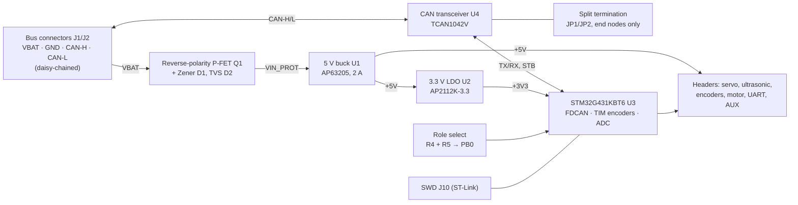

# CAN Node Board — rev A

One custom PCB that replaces the Arduino Mega + CAN Bus Shield stack on every node of a 4WD autonomous parking robot. The robot's three nodes (sensor, receive, motor) talk over CAN; each one now runs the **same board and the same firmware image**, and a single resistor tells the board which node it is.

| | |
|---|---|
| Input | 6–16 V (2S/3S LiPo, 6–8 AA, 12 V bench), reverse-polarity protected, TVS clamped |
| Rails | 5 V / 2 A synchronous buck (servo, ultrasonic sensor, CAN transceiver) · 3.3 V LDO (logic) |
| MCU | STM32G431KBT6 — Cortex-M4F 170 MHz, FDCAN, hardware quadrature-encoder timers |
| CAN | TCAN1042V transceiver, 5 V bus side / 3.3 V logic (VIO), 500 kbit/s classic CAN |
| Board | 76 × 56 mm, 4 layers (signal / GND / 3.3 V / signal), 4 × M3 holes |
| I/O | Servo, HC-SR04 ultrasonic, 2 × wheel encoder, motor driver (PWM + DIR × 2), UART, 2 spare GPIO, SWD |

## The feature worth pointing out: one PCB, one firmware image, every node

PB0 (an ADC input) sits in the middle of a divider: a fixed 10 kΩ pull-up (R4) and a **role resistor R5** to ground. At boot the firmware averages eight ADC samples, picks the nearest bin, and from that sets its CAN IDs, acceptance filters and which peripherals it starts.

| R5 fitted | V(ROLE) | Role |
|---|---|---|
| 0 Ω | 0.00 V | Sensor node (ultrasonic + servo) |
| 3.3 kΩ | 0.82 V | Receive node |
| 10 kΩ | 1.65 V | Motor node (encoders + motor driver) |
| 33 kΩ | 2.53 V | Spare |
| not fitted | 3.30 V | **Safe mode**: CAN listen-only, all outputs off |

- One pin carries five roles. Bins are about 0.8 V apart, so 5 % resistors can never land in the wrong one.
- Nothing to bump or misconfigure later, unlike a DIP switch, and it costs one 0603 part.
- An unfitted board fails safe: it can never drive the motors by accident.
- The same idea runs through the rest of the board: the transceiver's STB pin is pulled **high**, so a node stays off the bus until its firmware is ready, and CAN termination is a pair of solder jumpers (JP1 + JP2, split 2 × 60.4 Ω + 4.7 nF) closed only on the two end-of-bus boards. Every board is identical until it is configured.

The role table is printed on the back silkscreen, so the board documents itself.

## Block diagram

## Design decisions

**MCU and pins.** The STM32G431 has FDCAN built in (no separate CAN controller as on the MCP2515 shield) and timers with a hardware quadrature-encoder mode for the wheel encoders. On the 32-pin package, FDCAN TX only exists on PA12, which is also USB D+, so CAN and USB cannot both be used. The board drops USB and is programmed over SWD (ST-Link or a Nucleo's built-in one), with a 3-pin UART header for serial debug. PB8 doubles as BOOT0 and is pulled low, so the board always boots from flash.

| Pin | Function |
|---|---|
| PA11 / PA12 | FDCAN1 RX / TX |
| PA13 / PA14 | SWDIO / SWCLK |
| PA2 / PA3 | USART2 TX / RX (debug) |
| PB0 | ADC1_IN15, role select |
| PA0 | TIM2_CH1 input capture (ultrasonic echo, 32-bit timer) |
| PA1 | Ultrasonic trigger |
| PB4 | TIM16_CH1 servo PWM, 50 Hz |
| PA8 / PA9 | TIM1_CH1 / CH2 motor PWM, ~20 kHz |
| PA4 / PA5 | Motor direction |
| PB6 / PB7 | TIM4 encoder mode (left) |
| PA6 / PA7 | TIM3 encoder mode (right) |
| PF0 / PF1 | 8 MHz crystal (HSE) |
| PA10 | Status LED |
| PA15 | Transceiver STB |
| PB3 / PB5 | Spare GPIO on the AUX header |

The servo and the motors run on **different timers** because channels on one timer share a period: a servo needs 50 Hz, a motor driver about 20 kHz.

**Clock.** CAN bit timing needs a tighter clock than the internal RC oscillator gives, so an 8 MHz crystal drives the PLL. Load capacitors: C = 2 × (C_L − C_stray) = 2 × (10 − 3) pF ≈ 15 pF; match them to the crystal actually fitted.

**Power.** Q1 (AO3407A, −30 V, V_GS ±20 V) protects against a reversed battery with almost no voltage drop; the body diode conducts first, then the gate (pulled to ground through R1) turns the FET fully on. D1 clamps V_GS to 12 V and D2 (SMAJ18CA) clamps input transients from the motors. The buck uses the datasheet's typical-application values (10 µF in, 4.7 µH, 2 × 22 µF out, 100 nF bootstrap). C1 (47 µF) damps the input cable's inductance and C17 (220 µF) sits at the servo header to absorb stall-current spikes. VDDA is fed through a ferrite bead because the role pin is an analog measurement.

**Interfaces.** The HC-SR04 echo is a 5 V signal, divided to 3.33 V by R8/R9 (1 k / 2 k). Encoders are powered at 3.3 V with 10 kΩ pull-ups, which suits open-collector Hall encoders; if yours need 5 V, check that their outputs stay within the MCU's input limits. The motor header supplies 5 V for driver logic and takes 3.3 V PWM/DIR.

**Layout.** Four layers: In1 is an unbroken ground plane under everything, In2 is the 3.3 V plane, and the outer layers carry signals with ground pours. Every surface-mount ground and 3.3 V pad has its own via to its plane. The buck's input capacitor sits right next to its VIN and GND pins and the switch node is a short, wide copper run to the inductor. Power nets use 0.6–0.8 mm tracks, CAN-H/L 0.25 mm, signals 0.2 mm, with 0.2 mm clearance and 0.6/0.3 mm vias, all within standard 4-layer capabilities at JLCPCB and PCBWay.

## Verification status

- Schematic connectivity checked against the intended netlist (all 43 nets match); every power-input net has a driver or power flag.
- PCB DRC (KiCad 7.0.11): **0 violations, 0 unconnected pads, 0 footprint errors**.
- **Not yet fabricated or tested.** Bring-up plan for the first boards:
  1. Check for shorts between VBAT, 5 V, 3.3 V and GND before applying power.
  2. Power from a current-limited bench supply (12 V, 100 mA limit) and check 5 V and 3.3 V.
  3. Flash a blink + role-readout firmware over SWD; confirm the status LED blinks the role number.
  4. Two boards on a short bus with JP1/JP2 closed at each end: send and receive frames at 500 kbit/s.
  5. Connect the servo, sensor, encoders and motor driver one at a time.

## Files

| Path | Contents |
|---|---|
| `kicad/` | KiCad project: schematic, PCB, project symbol library (TCAN1042V) |
| `docs/schematic.pdf` | Schematic, one A3 sheet |
| `docs/render-3d.png`, `render-top.png`, `render-bottom.png` | Board renders |
| `docs/layout-top.png`, `layout-bottom.png` | Copper and silkscreen plots (pours hidden) |
| `docs/can-node.step` | 3D model of the assembled board |
| `fab/can-node-gerbers.zip` | Gerbers (4 layers) + Excellon drill files, origin at the board's bottom-left corner |
| `fab/can-node-bom.csv` | Bill of materials (part numbers are examples; R5 is fitted per role) |
| `fab/can-node-cpl.csv` | Pick-and-place positions for assembly |

Ordering: 4 layers, 1.6 mm FR-4, 1 oz outer copper, any surface finish. Upload `can-node-gerbers.zip` as-is.

Designed in KiCad 7; the project opens in KiCad 8 and 9 (KiCad offers to upgrade the file format on first save).

